<div align="center">


<br>


**A clean, modern web application to manage patients, appointments, messages and feedback — with a live analytics dashboard.**

[Overview](#-overview) · [Screenshots](#-screenshots) · [Features](#-features) · [Architecture](#-architecture) · [Getting started](#-getting-started) · [Roadmap](#-roadmap)

</div>


## 📖 Overview

**MediFolio** replaces paper-based filing in a small healthcare practice with a simple digital workspace. Staff can register patients, follow their next visits, read incoming messages and collect patient feedback — all from one screen, with a dashboard that turns the raw records into charts and key figures.

| | |
|---|---|
| 🎯 **Goal** | Give a medical office a fast, readable and dependable view of its day-to-day activity |
| 🧩 **Modules** | Dashboard · Patients · Messages · Feedbacks · Public contact form |
| 🏗️ **Pattern** | MVC on Symfony, Doctrine ORM, Twig templates, small service layer |
| 🎨 **UI** | Custom design system on top of Bootstrap 5.3, responsive, keyboard-friendly |

---

## 📸 Screenshots

<div align="center">

### Dashboard
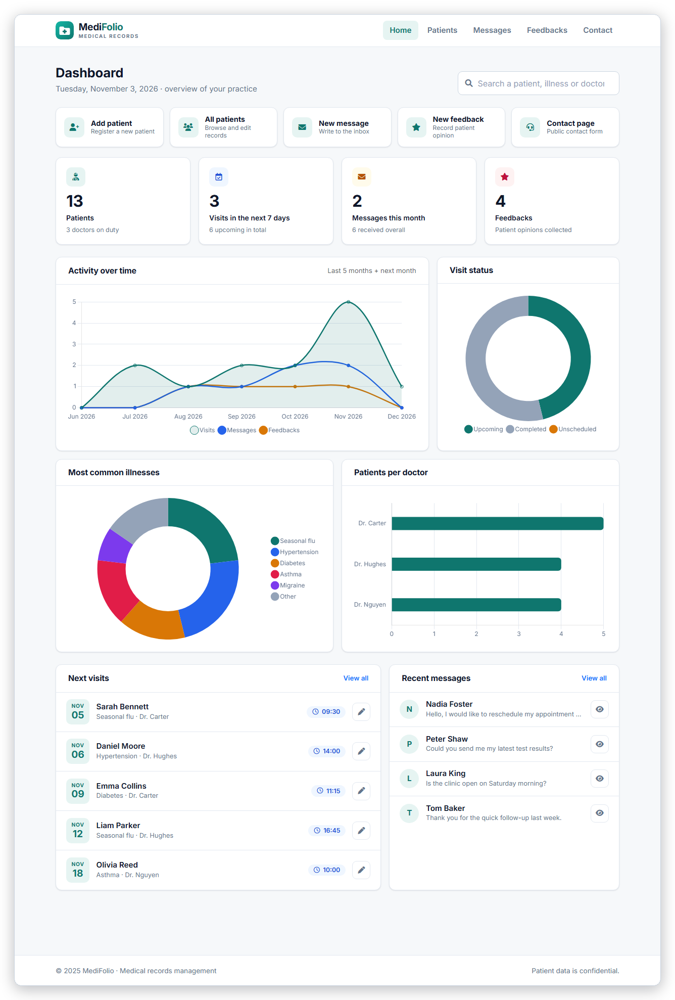

<sub>Quick actions · key figures · activity curve · visit status · illness distribution · patients per doctor · next visits · recent messages</sub>

</div>

<br>

<table>
  <tr>
    <td width="50%" align="center"><b>Patients</b> — search, edit, delete<br><br>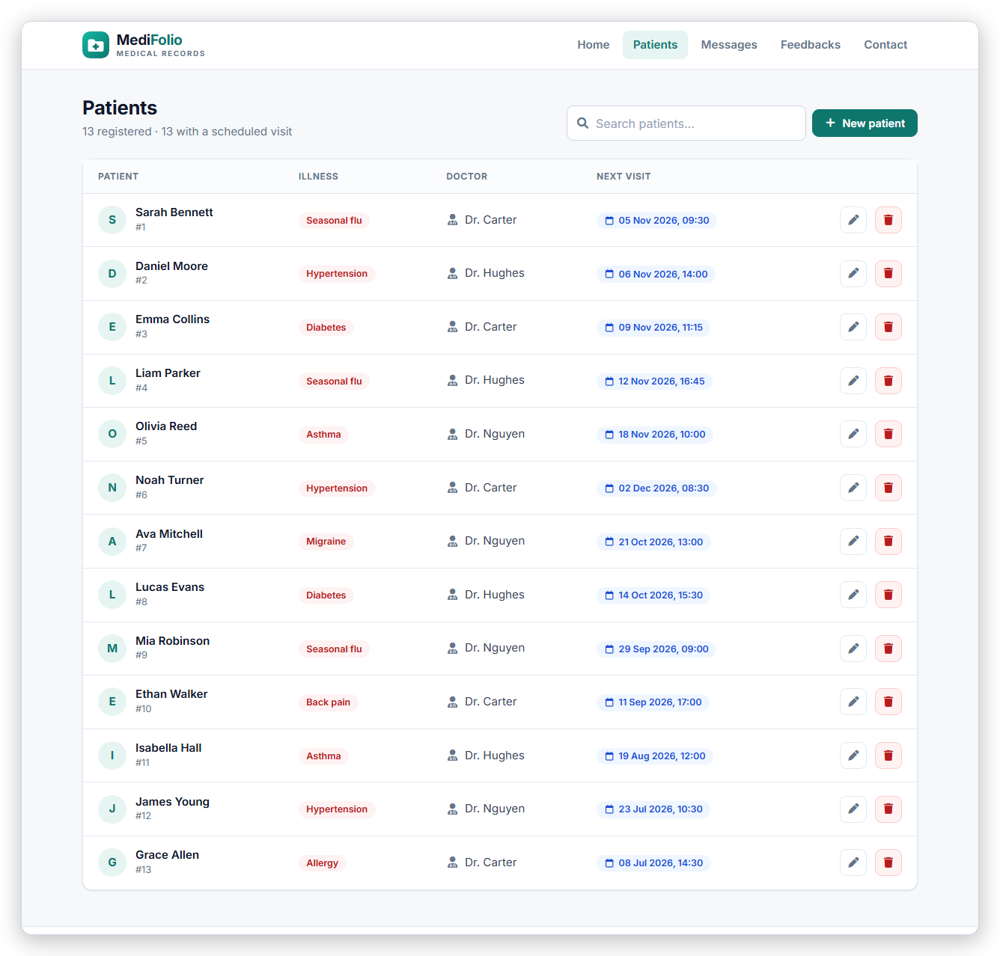</td>
    <td width="50%" align="center"><b>New patient</b> — clear, validated form<br><br>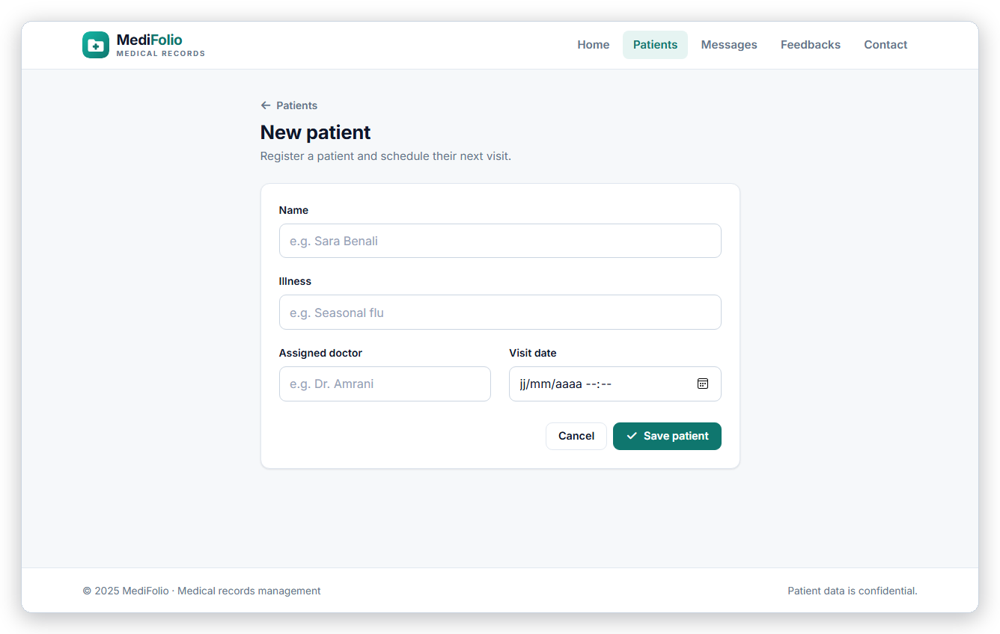</td>
  </tr>
  <tr>
    <td width="50%" align="center"><b>Edit patient</b> — with a protected danger zone<br><br>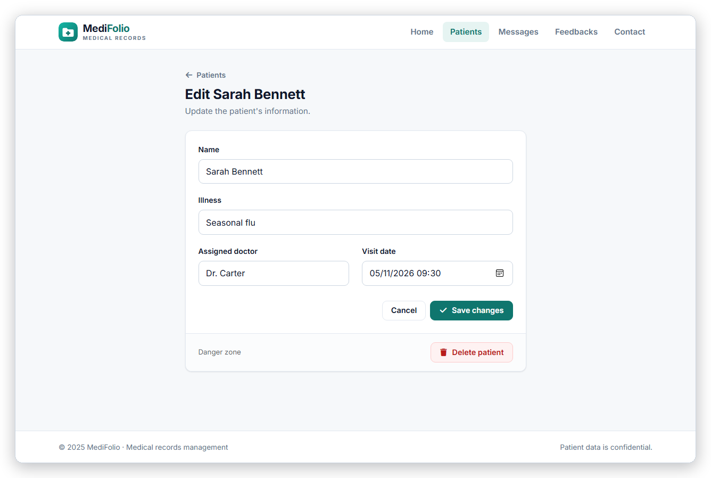</td>
    <td width="50%" align="center"><b>Messages</b> — inbox with quick actions<br><br>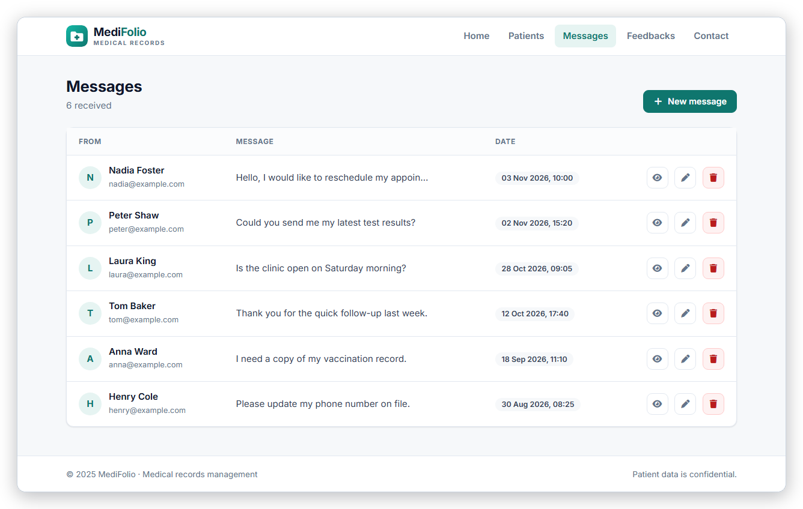</td>
  </tr>
  <tr>
    <td width="50%" align="center"><b>Feedbacks</b> — patient opinions<br><br>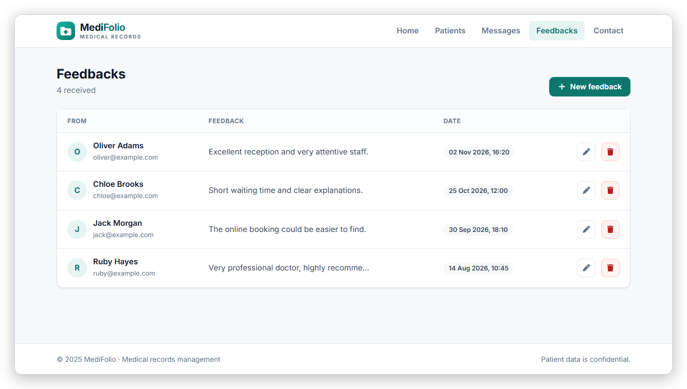</td>
    <td width="50%" align="center"><b>Contact</b> — public form<br><br>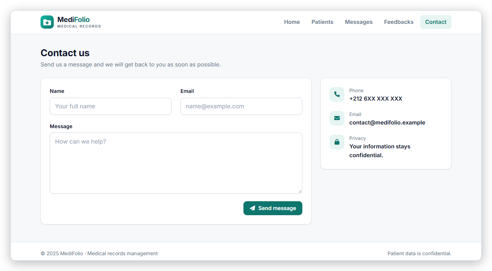</td>
  </tr>
</table>

<div align="center">

### Responsive
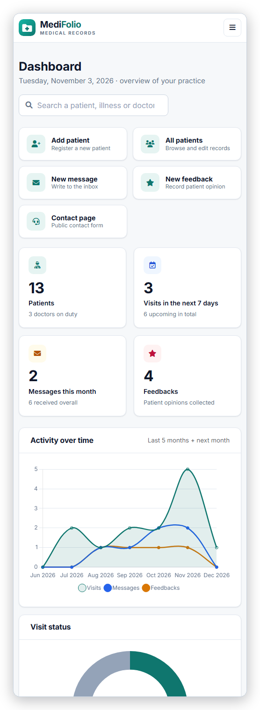

</div>

---

## ✨ Features

<table>
  <tr>
    <td width="33%" valign="top">

### 📊 Dashboard
- 4 key figures: patients, visits in the next 7 days, messages this month, feedbacks
- **Line chart** — visits, messages and feedbacks over 7 months
- **Doughnut charts** — visit status and most common illnesses
- **Bar chart** — patients per doctor
- Next 5 visits and 4 latest messages
- Empty states when there is no data

  </td>
    <td width="33%" valign="top">

### 🏥 Patients
- Full **CRUD** (create, read, update, delete)
- Illness, assigned doctor, next visit
- **Instant search** by name, illness or doctor
- Confirmation modal before any deletion
- Friendly empty and "no result" states

  </td>
    <td width="33%" valign="top">

### 💬 Messages & Feedback
- Public **contact form** with validation
- Admin inbox: list, view, edit, delete
- Feedback module with full CRUD
- Flash notifications after actions
- Clear timestamps on every entry

  </td>
  </tr>
</table>

### 🧭 Convenience options

| Option | Where | What it does |
|---|---|---|
| ⚡ **Quick actions** | Dashboard | One-click shortcuts: add patient, all patients, new message, new feedback, contact page |
| 🔎 **Global search** | Dashboard & Patients | Find a patient by name, illness or doctor |
| 🗓️ **Next visits** | Dashboard | See the 5 upcoming appointments and jump straight to the record |
| 📨 **Recent messages** | Dashboard | Read the latest inquiries without leaving the home page |
| 🛡️ **Safe deletion** | Everywhere | Every delete asks for confirmation and is CSRF-protected |
| 📱 **Responsive layout** | All pages | Collapsible menu and fluid tables on phones and tablets |

---

## 🏛️ Architecture

### System overview

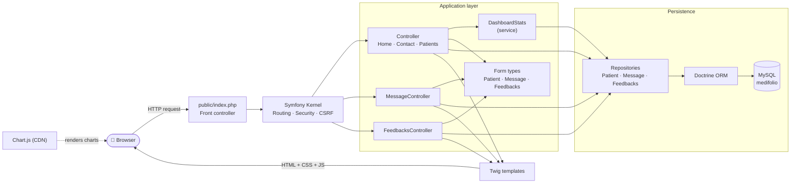

### Request lifecycle — creating a patient

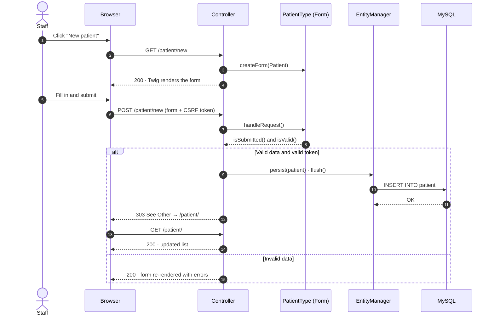

### Dashboard data pipeline

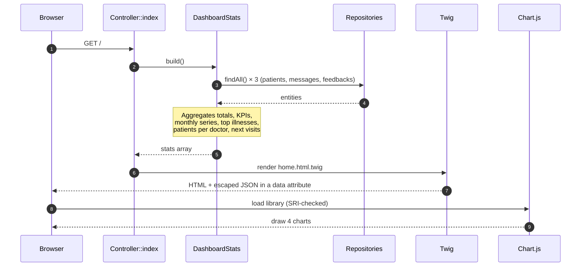

### Domain model

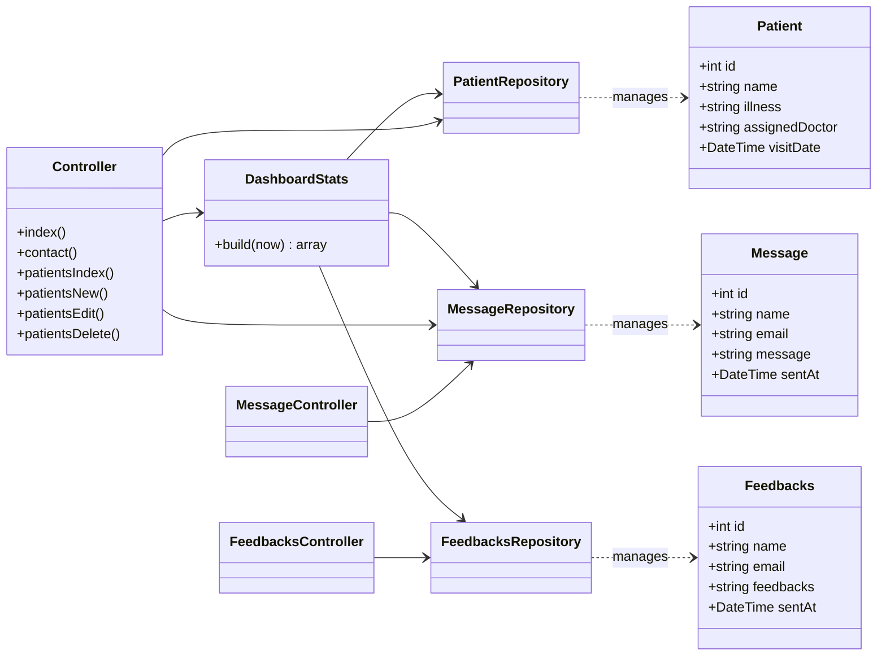

### Database schema

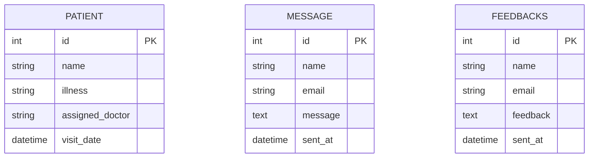

> The three tables are independent aggregates by design — no foreign keys — which keeps each module simple to evolve.

### Use cases

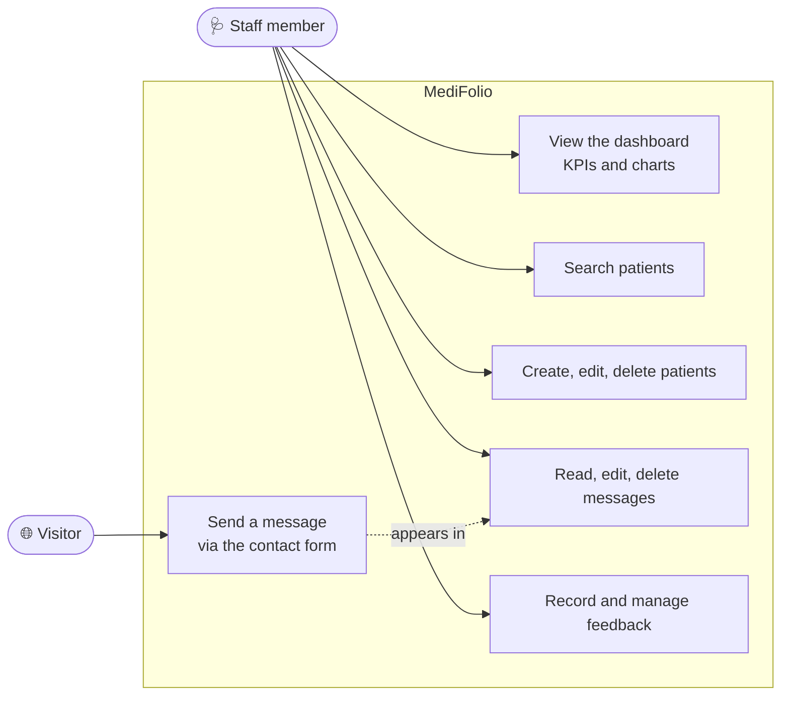

### Visit status (derived from the visit date)

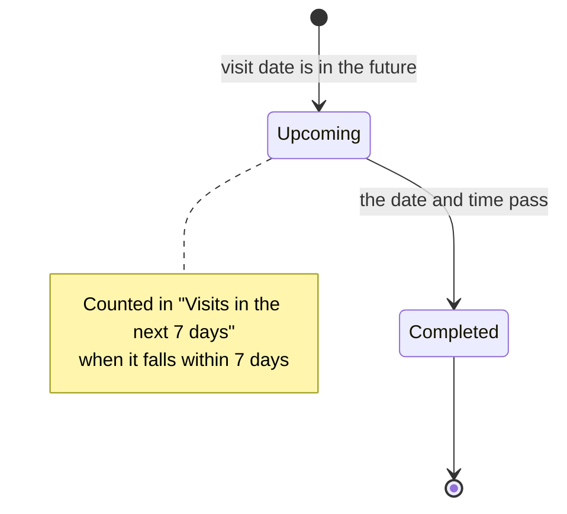

---

## 🧭 Routes

| Method | URL | Route name | Description |
|---|---|---|---|
| `GET` | `/` | `index` | Dashboard |
| `GET` `POST` | `/contact` | `contact` | Public contact form |
| `GET` | `/patient/` · `?q=term` | `patient_index` | Patients list and search |
| `GET` `POST` | `/patient/new` | `patient_new` | Create a patient |
| `GET` `POST` | `/patient/{id}/edit` | `patient_edit` | Edit a patient |
| `POST` | `/patient/{id}` | `patient_delete` | Delete a patient (CSRF) |
| `GET` | `/message/` | `message_index` | Messages inbox |
| `GET` `POST` | `/message/new` | `message_new` | Create a message |
| `GET` | `/message/{id}` | `message_show` | View a message |
| `GET` `POST` | `/message/{id}/edit` | `message_edit` | Edit a message |
| `POST` | `/message/{id}` | `message_delete` | Delete a message (CSRF) |
| `GET` | `/feedbacks/` | `Feedbacks_index` | Feedbacks list |
| `GET` `POST` | `/feedbacks/new` | `Feedbacks_new` | Create a feedback |
| `GET` `POST` | `/feedbacks/{id}/edit` | `Feedbacks_edit` | Edit a feedback |
| `POST` | `/feedbacks/{id}` | `Feedbacks_delete` | Delete a feedback (CSRF) |

---

## 🗂️ Project structure

```text
Medical-Records-System/
├── assets/
│   ├── styles/app.css            # Design system (tokens, components, dashboard)
│   └── controllers/              # Stimulus controllers
├── config/
│   ├── packages/                 # Doctrine, Twig, security, framework…
│   └── routes.yaml
├── docs/
│   ├── images/                   # Animated banner and divider (SVG)
│   ├── screenshots/              # Screenshots used in this README
│   └── demo-data.sql             # Optional demo data
├── migrations/                   # Database schema (Doctrine Migrations)
├── public/
│   └── index.php                 # Front controller
├── src/
│   ├── Controller/               # Home, Patients, Messages, Feedbacks
│   ├── Entity/                   # Patient, Message, Feedbacks
│   ├── Form/                     # Form types
│   ├── Repository/               # Doctrine repositories
│   └── Service/DashboardStats.php# Dashboard figures and chart series
├── templates/
│   ├── _ui/                      # Shared components (field, delete modal, logo, form page)
│   ├── patient/ message/ Feedbacks/
│   ├── base.html.twig            # Layout: header, navigation, flash messages, footer
│   └── home.html.twig            # Dashboard
├── router.php                    # Router for PHP's built-in server
└── start-server.bat              # One-click launcher (Windows / XAMPP)
```

---

## 🧰 Tech stack

| Layer | Technology |
|---|---|
| **Language** | PHP 8.2+ |
| **Framework** | Symfony 7.4 (Routing, Forms, Security/CSRF, Twig, AssetMapper) |
| **ORM & migrations** | Doctrine ORM 3 · Doctrine Migrations |
| **Database** | MySQL 8 / MariaDB |
| **Front-end** | Twig · Bootstrap 5.3 · custom CSS design system · Font Awesome 6 · Inter font |
| **Charts** | Chart.js 4.4 (loaded with Subresource Integrity) |
| **Tooling** | Composer · Symfony Web Profiler (dev) |

### 🎨 Design system

| Token | Value | Usage |
|---|---|---|
|  Primary | `#0f766e` | Actions, active navigation, brand |
|  Primary dark | `#115e59` | Hover states |
|  Ink | `#0f172a` | Headings |
|  Muted | `#64748b` | Secondary text |
|  Info | `#2563eb` | Dates, messages series |
|  Warning | `#d97706` | Feedback series |
|  Danger | `#b91c1c` | Deletion, illness tags |

Principles: **simple** (one accent colour), **consistent** (shared components for fields, tables, modals, icons), **accessible** (visible focus, labelled controls, `aria-label` on icon buttons, reduced-motion friendly animations).

---

## 🚀 Getting started

### Prerequisites

- PHP **8.2+** with the `pdo_mysql`, `ctype` and `iconv` extensions
- [Composer](https://getcomposer.org/)
- MySQL 8 or MariaDB (XAMPP works great)

### Installation

```bash
# 1. Clone
git clone https://github.com/Lagmouchyoussef/Medical-Records-System.git
cd Medical-Records-System

# 2. Install PHP dependencies
composer install

# 3. Configure the database (create .env.local to keep your credentials out of git)
echo 'DATABASE_URL="mysql://root:@127.0.0.1:3306/medifolio?serverVersion=8.0&charset=utf8mb4"' > .env.local

# 4. Create the database and the schema
php bin/console doctrine:database:create
php bin/console doctrine:migrations:migrate --no-interaction

# 5. Download the JavaScript packages (Stimulus, Turbo)
php bin/console importmap:install

# 6. (Optional) load demo data so the dashboard has something to show
mysql -u root medifolio < docs/demo-data.sql

# 7. Run the app
php -S 127.0.0.1:8088 -t public router.php
```

Open **http://127.0.0.1:8088** 🎉

> **Windows + XAMPP:** start MySQL from the XAMPP control panel, then double-click [`start-server.bat`](start-server.bat). It launches the server and opens your browser.
>
> **Symfony CLI users:** `symfony server:start` works too.

### Useful commands

| Command | Purpose |
|---|---|
| `php bin/console doctrine:schema:validate` | Check that entities and database are in sync |
| `php bin/console doctrine:migrations:status` | Show migration status |
| `php bin/console lint:twig templates` | Validate all Twig templates |
| `php bin/console cache:clear` | Clear the cache |
| `php bin/console debug:router` | List all routes |

---

## 🔐 Security notes

- ✅ **CSRF protection** on every Symfony form and on all delete actions
- ✅ **Output escaping** in Twig; chart data is passed through an HTML-escaped attribute, never as raw script content
- ✅ **Subresource Integrity** on the Chart.js CDN script
- ✅ **Doctrine parameter binding** — no hand-written SQL in the application
- ⚠️ **No authentication yet.** Every page is open. Do **not** expose this application to the public internet until a login and role system is added (see the roadmap).

---

## 🗺️ Roadmap

- [x] Patients, messages and feedbacks CRUD
- [x] Public contact form
- [x] Analytics dashboard with charts and key figures
- [x] Patient search and quick actions
- [x] Responsive design system
- [ ] Authentication and roles (administrator, doctor, receptionist)
- [ ] Pagination and column sorting on lists
- [ ] Automated tests (PHPUnit) for services and controllers
- [ ] Appointment reminders by e-mail
- [ ] CSV / PDF export of patient lists
- [ ] Dark mode
- [ ] Docker setup

---

## 🤝 Contributing

Contributions, issues and feature requests are welcome.

1. Fork the project
2. Create your feature branch — `git checkout -b feature/amazing-feature`
3. Commit your changes — `git commit -m "Add amazing feature"`
4. Push the branch — `git push origin feature/amazing-feature`
5. Open a pull request

---

## 👤 Author

**Lagmouch Youssef** — [@Lagmouchyoussef](https://github.com/Lagmouchyoussef)


<div align="center">
  <sub>© 2025 MediFolio · Built with Symfony, Doctrine and care.</sub>
</div>
